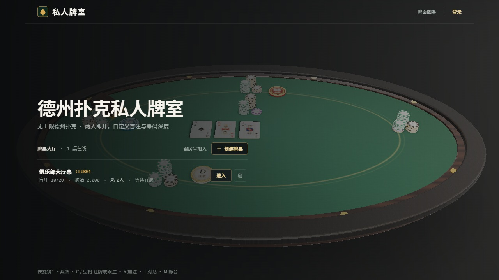
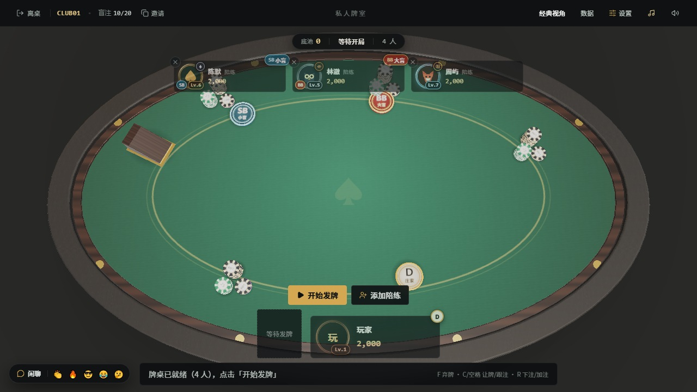
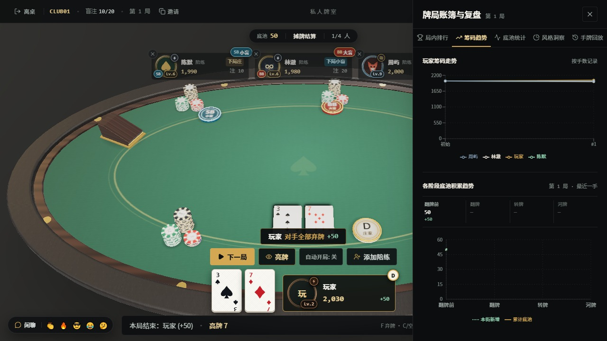
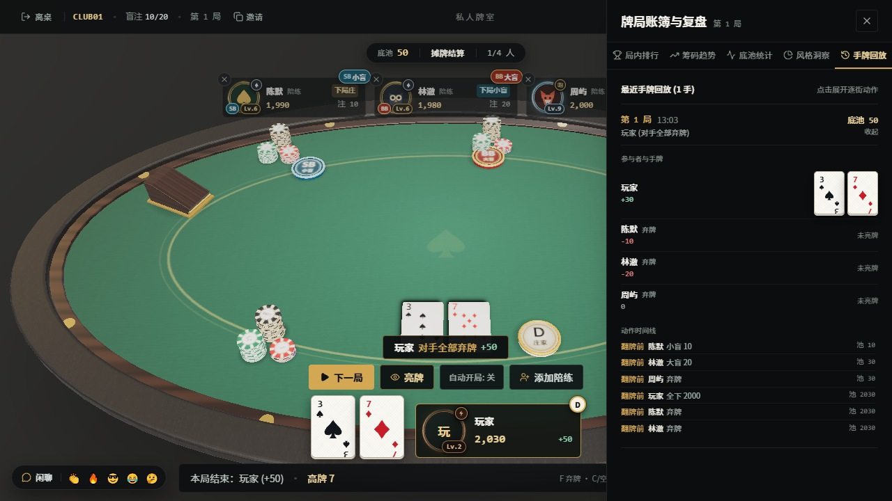

# 德州扑克私人牌室

一个可以和朋友在线同桌的德州扑克牌室。打开大厅，选桌入座，开始一局。牌桌使用 Three.js 绘制，也能在经典斜视和俯瞰视角之间切换。



## 从大厅到牌桌

进入大厅后，可以加入现有房间或创建牌桌。入座时填写昵称并选择头像。牌桌中可以复制邀请链接，让朋友进入同一房间。至少两名玩家在桌上即可开始发牌，也可以添加陪练。



牌局中可以弃牌、让牌、跟注、下注、加注或全下。桌面显示底池、盲注、当前行动玩家和结算结果。右上角的视角按钮可切换经典斜视与俯瞰视角。浏览器无法使用 WebGL 时，牌桌会切换为 2D 画面。

牌桌还提供快捷表情和聊天、音效与背景音乐开关。结束一手后，可以查看局内排名、筹码趋势、底池统计和手牌回放。

| 筹码趋势 | 手牌回放 |
| --- | --- |
|  |  |

手牌回放展示参与者、已亮出的手牌、每人的筹码变化，以及按顺序记录的行动和底池变化。截图中的「玩家」是本地演示使用的访客昵称。

## 在自己电脑上运行

需要 Node.js 22.5 或更新版本。

```bash
npm install
npm run dev
```

启动后打开 <http://localhost:3000>。`index.html` 需要通过项目服务访问，牌局状态由服务端管理。

项目提供 `npm run build` 构建前后端，构建后可运行 `npm start`。本地数据默认保存在 `data` 目录。可参考 `.env.example` 配置端口、数据目录和其他可选服务。

## 和朋友一起玩

同一局的玩家需要连接到同一台正在运行的服务。进入牌桌后点击「邀请」，将房间链接发给朋友。朋友打开链接并填写昵称即可入座。

同一局域网内，可以使用主机的局域网地址。异地联机需要将项目部署到可访问的服务器，或为本地服务创建临时公网地址。通过公网地址进入牌桌后再复制邀请链接，朋友收到的链接才会指向同一台服务。运行服务和公网通道的电脑需要在游戏期间保持在线。

## 项目结构

```text
src/             页面、牌桌组件与游戏界面
server/          房间、玩家和牌局服务逻辑
server.ts        HTTP 与 WebSocket 服务入口
assets/readme/   本项目的实机截图
```

本 README 中的截图来自本项目本地运行画面。项目使用 React、Vite、Three.js、Express、WebSocket 和 SQLite。
